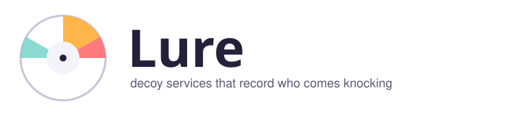
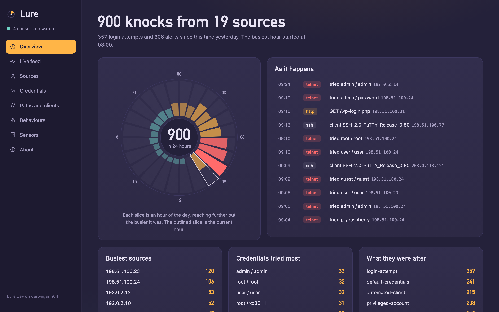
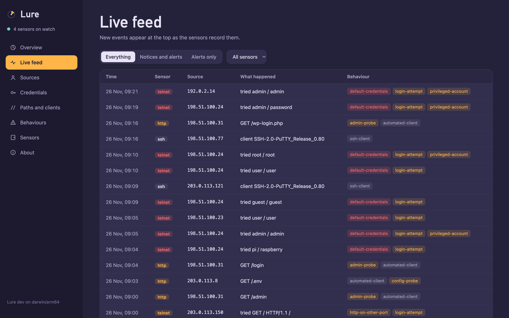
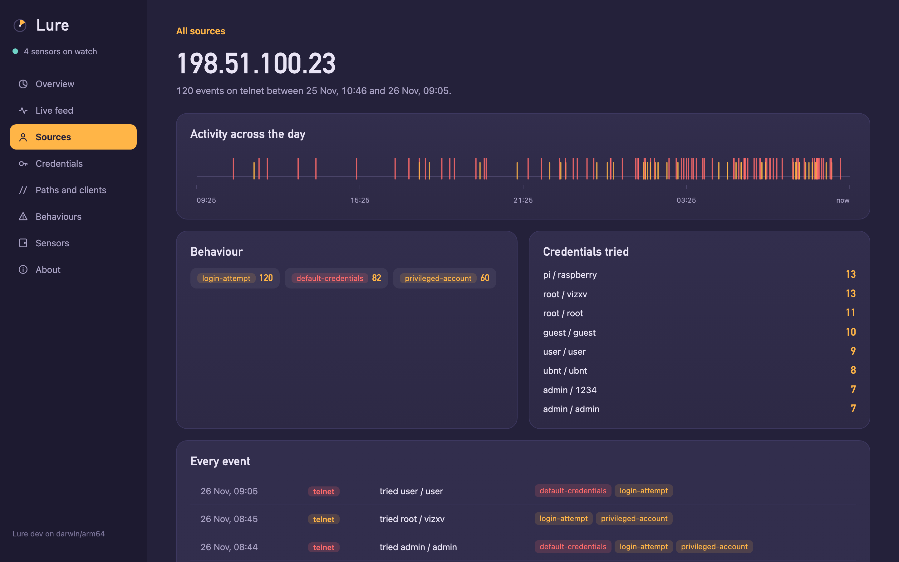
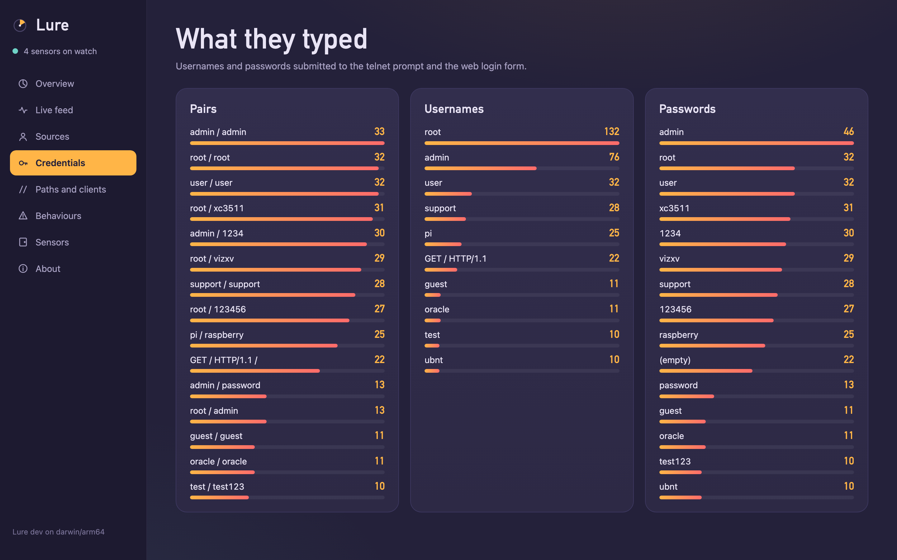
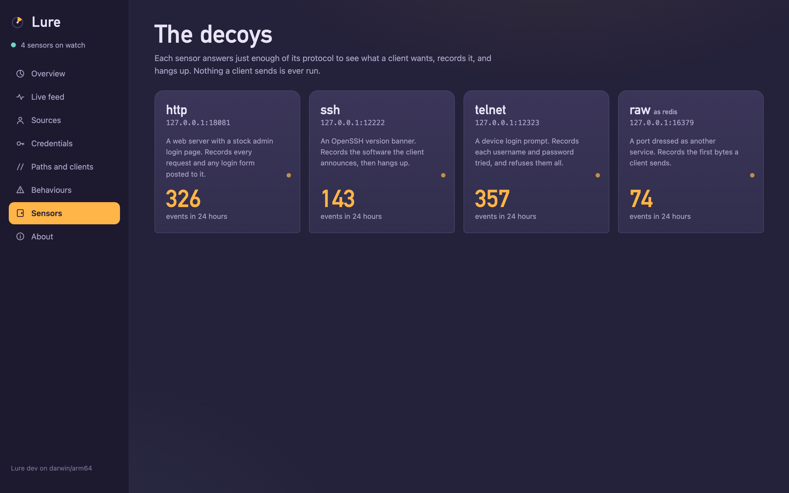

<picture>
  <source media="(prefers-color-scheme: dark)" srcset="docs/assets/wordmark-dark.svg">
  
</picture>

[](https://github.com/cansarihan/lure/actions/workflows/ci.yml)
[](https://github.com/cansarihan/lure/actions/workflows/codeql.yml)
[](https://goreportcard.com/report/github.com/cansarihan/lure)
[](go.mod)
[](LICENSE)

Lure runs services nobody should use — a web login page, an SSH banner, a telnet
prompt, a port dressed as Redis — and records everyone who comes knocking.
Because no legitimate client has a reason to connect, everything it sees is a
scan, a probe or an automated login attempt.

Each decoy answers just enough of its protocol to make a client show what it
wanted, records it, and hangs up. Nothing a client sends is ever run. Events are
tagged by behaviour, rolled up by source, kept in memory and written to a JSON
Lines journal. One binary, no dependencies outside the standard library.



## Run it

```console
$ lure run -sensor http=:8080 -sensor ssh=:2222 -sensor telnet=:2323 -sensor raw:redis=:6379 \
           -panel 127.0.0.1:9000 -journal events.jsonl
level=INFO msg="sensor listening" sensor=http addr=[::]:8080
level=INFO msg="sensor listening" sensor=ssh addr=[::]:2222
level=INFO msg="sensor listening" sensor=telnet addr=[::]:2323
level=INFO msg="sensor listening" sensor=raw addr=[::]:6379
level=INFO msg="panel listening" addr=127.0.0.1:9000
```

Map the privileged ports to these on the host (22 → 2222, 23 → 2323, 80 → 8080)
and keep the panel on a private address, or set `-token`.

## The panel

The overview reads the last day as a watch dial: each slice is an hour, reaching
further out the busier it was. Beside it the feed fills as events arrive. Every
source opens with a strip of its activity across the day, what it tried, and
each event it caused.

| | |
|---|---|
|  |  |
|  |  |

## Behaviours

Every event is checked against a catalogue of rules, and takes the highest
severity it matches.

| Severity | Behaviours |
|---|---|
| Alert | factory credentials, path traversal, `${jndi:` lookups, SQL and shell injection strings |
| Notice | probes for `.env`, `.git/` and backups, admin and router login pages, logins as root, a TLS handshake or HTTP request on a plain-text port, Redis commands |
| Info | scanner and scripting user agents, missing user agents, SSH client software |

`lure rules` prints the full catalogue.

## From the journal

```console
$ lure report -journal events.jsonl
900 events from 19 sources

SOURCE          EVENTS  LOGINS  SENSORS   LAST SEEN
198.51.100.23   120     120     [telnet]  2026-11-26T09:02:00Z
198.51.100.24   106     106     [telnet]  2026-11-26T09:21:00Z
...

Credentials tried
     33  admin / admin
     32  root / root
```

## Commands

```console
$ lure run                    # start decoys and the panel
    -sensor kind=addr   repeatable: http, ssh, telnet, raw[:label]
    -panel addr         operator panel address (empty disables it)
    -journal file       append events to a JSON Lines file and reload it at start
    -token value        require a token on the panel (or LURE_TOKEN)
    -seed n             preload n synthetic events for a demo
$ lure report -journal file   # sources, behaviours, credentials and paths
$ lure rules                  # the behaviour catalogue
$ lure version
```

## HTTP API

```console
GET /api/v1/status              build, uptime and the listening sensors
GET /api/v1/summary             sources, rankings and the 24-hour histogram
GET /api/v1/events              recent events; filter with sensor, severity, remote, tag, limit
GET /api/v1/sources/{address}   one source with every event it caused
GET /api/v1/rules               the behaviour catalogue
GET /api/v1/stream              server-sent events as they are recorded
```

## Run the demo

The demo runs all four decoys on loopback-only ports and preloads a day of
synthetic events. Their source addresses come from the RFC 5737 documentation
ranges, so no real host is named.

```sh
make demo          # panel at http://127.0.0.1:18210
make demo-down
make run           # the same without Docker
```

## How it works

See [docs/architecture.md](docs/architecture.md). Every sensor shares one accept
loop with a per-connection deadline and a read limit; a single recorder tags
each event, keeps it in a ring that streams to the panel, and appends it to the
journal.

## Build

```sh
make build         # ./bin/lure
make test
make lint
```

## License

MIT. See [LICENSE](LICENSE).
