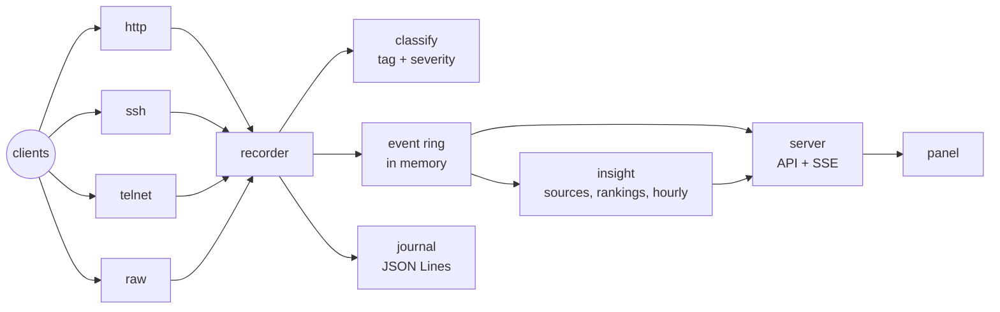

# Architecture

Lure is a set of decoy services, a recorder behind them, and a panel in front of
the recorder.

## Why decoys work

No legitimate client has a reason to connect to a service nobody announced.
Anything that reaches a Lure sensor is therefore a scanner, a crawler, or an
automated login attempt, and the record has almost no noise to filter.

## Sensors

Each sensor answers just enough of its protocol to make a client show what it
wanted, then hangs up.

| Sensor | Answers with | Records |
|---|---|---|
| `http` | a stock admin login page, or a 404 | method, path, query, user agent, body; posted login forms |
| `ssh` | an OpenSSH version banner | the identification line the client sends back |
| `telnet` | a device login prompt, three tries | every username and password, all refused |
| `raw` | nothing | the first bytes a client sends, as hex and text |

All of them share one accept loop that sets a deadline on every connection and
reads through a size limit. Nothing a client sends is executed, stored as a
file, or forwarded anywhere.

## Packages

- `internal/sensor` holds the decoys, the shared bounded accept loop, and the
  listener specs (`http=:8080`, `raw:redis=:6379`). Starting is all or nothing:
  if one port fails to bind, the ones already opened are closed.
- `internal/classify` tags each event with the behaviours it shows — an
  automated client, a probe for `.env` or `/wp-login.php`, factory
  credentials, a TLS handshake on a plain-text port — and takes the highest
  rule severity as the event's.
- `internal/recorder` is the single sink: classify, keep in the ring, append to
  the journal. On start it replays the journal through the classifier, so rule
  changes apply to old events too.
- `internal/event` is the event model and a bounded ring that fans new events
  out to subscribers without ever blocking a sensor.
- `internal/journal` appends JSON Lines and reads them back, skipping a line torn
  by a crash.
- `internal/insight` rolls events into sources, credential and path rankings,
  client software, and a 24-hour histogram.
- `internal/server` serves the API, a server-sent event stream of new events,
  and the embedded panel.
- `internal/seed` builds a day of synthetic events for the demo. It never
  touches the network, and every source address comes from the RFC 5737
  documentation ranges.

## Deploying

Run the decoys on a host you control that holds nothing else of value, map
privileged ports (22, 23, 80) to the unprivileged ones Lure listens on, and keep
the panel on a private address or behind `-token`.
